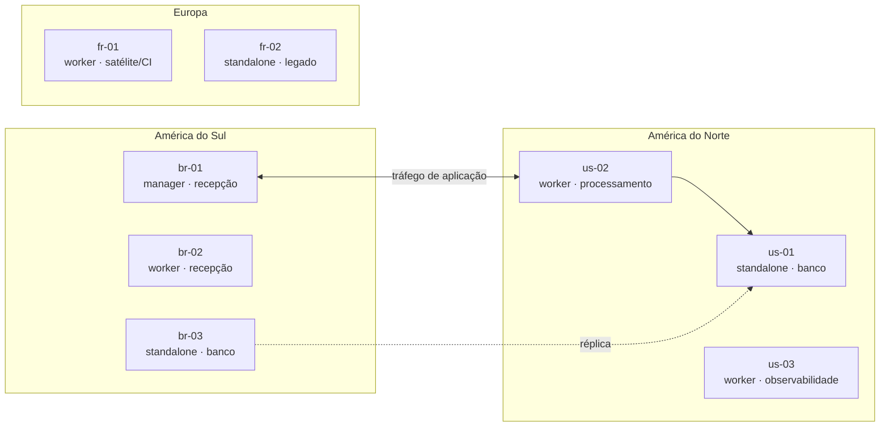

# 01 — Contexto

## O ambiente

Oito servidores, três regiões, um único time pequeno.

| Região | Hosts | Papel principal |
|---|---|---|
| América do Sul | `br-01`, `br-02`, `br-03` | Recepção de telemetria, filas Kafka, banco secundário |
| América do Norte | `us-01`, `us-02`, `us-03` | Banco principal, processamento, observabilidade |
| Europa | `fr-01`, `fr-02` | Recepção via satélite, CI e um host legado |

O cluster Docker Swarm tinha **1 manager e 4 workers**. Três hosts rodavam Docker em
modo `standalone`, fora do cluster — descoberta que só apareceu na auditoria.

## O fluxo de negócio

Equipamentos instalados nos veículos enviam posições e alertas. Os dados entram por
gateways de recepção, passam por uma fila Kafka, são validados e enriquecidos por
hubs de processamento e terminam em um banco principal. Um banco secundário e
réplicas regionais completam a operação.

Em cima disso: observabilidade (métricas, logs, painéis), compartilhamento de
arquivos, painéis de relatório e aplicações web.

A maior parte do tráfego de recepção é **UDP e em tempo real**. Latência importa, e
perder pacote é perder evento.

## Restrições reais

1. **Time pequeno.** Sem SRE dedicado, sem plantão 24/7 formal. Quem mudava também
   apagava incêndio.
2. **Serviço não podia parar.** Janelas de manutenção eram exceção, não rotina.
3. **Hardware próprio / colocation.** Sem elasticidade de cloud. Migrar região
   significava comprar e provisionar máquina.
4. **Um host legado.** SO fora de suporte, mantido por dependência de aplicação.
5. **Conhecimento concentrado.** O "como está configurado" vivia na cabeça de duas
   ou três pessoas e em comandos no histórico do shell.

## O que existia

- Uma pasta de documentos que descrevia a intenção, não o estado.
- Mudanças feitas direto no servidor: `docker service update`, `ufw allow`, ajuste
  de arquivo com `nano`.
- Relatórios de auditoria feitos manualmente, em ferramentas diferentes, com
  formatos diferentes.
- Nenhum baseline: cada host tinha sua própria história de pacotes e ajustes.

## O que doía, em concreto

| Dor | Sintoma |
|---|---|
| Sem trilha de mudança | "Alguém liberou essa porta" sem autor, data ou motivo. |
| Host não reproduzível | Dois nós com o mesmo papel e versões de kernel diferentes. |
| Firewall divergente | A matriz de portas não batia com o `ufw status` de dois hosts. |
| Auditoria cara | Levantar pacotes e containers dos 8 hosts levava dias, e o resultado já nascia velho. |
| Incidente sem runbook | Diagnóstico improvisado, evidência perdida no primeiro reboot. |

## O ponto de virada

O ambiente não caiu. Nada explodiu. O que aconteceu foi mais lento e mais caro:
**ninguém conseguia provar que dois servidores eram iguais** — nem que a
configuração de hoje era a mesma de ontem.

Foi essa pergunta que virou projeto: *como fazer o servidor deixar de ser o lugar
onde a verdade mora?*
